<p align="center">
  
</p>

<h1 align="center">Area Play</h1>
<p align="center"><b>Un launcher de jeux rapide et soigné pour PS Vita</b><br>Vita Edition</p>

<p align="center">
  <a href="../../releases/latest"></a>
  
  
</p>

<p align="center">
  <a href="https://youtu.be/WNm3kU46JUY">▶ Voir le trailer</a> ·
  <a href="../../releases/latest">⬇ Télécharger</a> ·
  <a href="README.md">English version</a>
</p>

---

**Area Play** met toute votre collection PS Vita sur un seul écran : **jeux PS Vita, jeux PSP et PS1, consoles rétro et homebrews**, avec les jaquettes et les fonds téléchargés automatiquement. Choisissez un jeu, appuyez sur ✕, jouez. Quand vous avez fini, vous pouvez revenir directement dans Area Play.

C'est une appli qu'on lance depuis sa bulle, par-dessus le LiveArea : rien n'est remplacé dans le système, et elle se supprime comme n'importe quelle appli.

> Conçu, dessiné et testé par moi sur une vraie PS Vita, développé avec l'aide d'une IA.

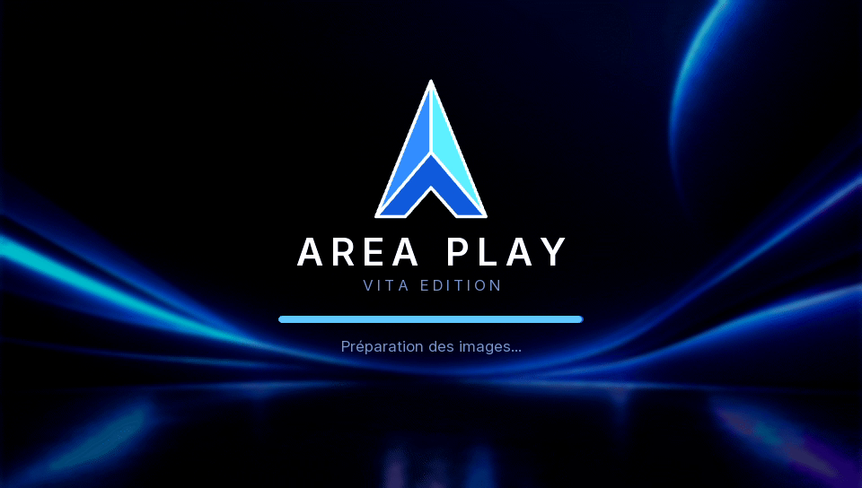

<table>
  <tr>
    <td>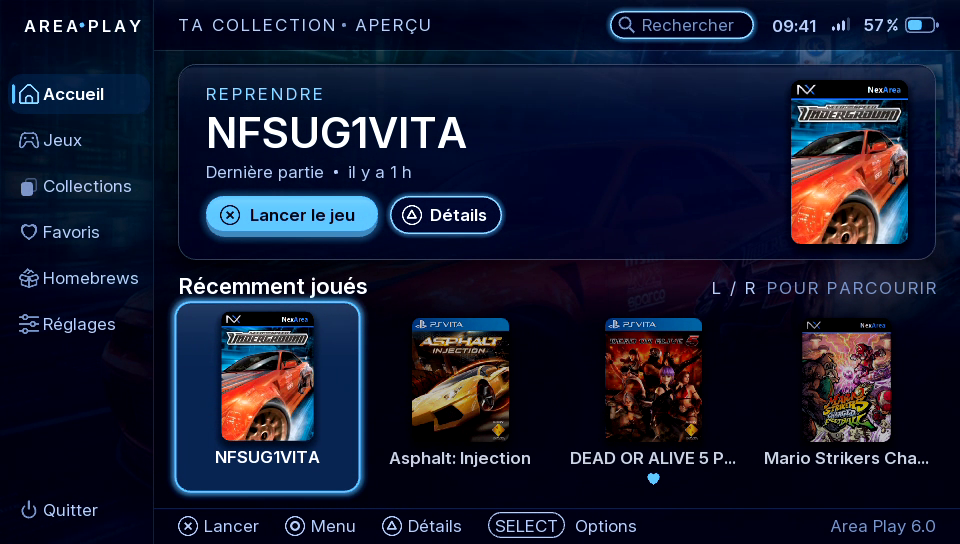</td>
    <td>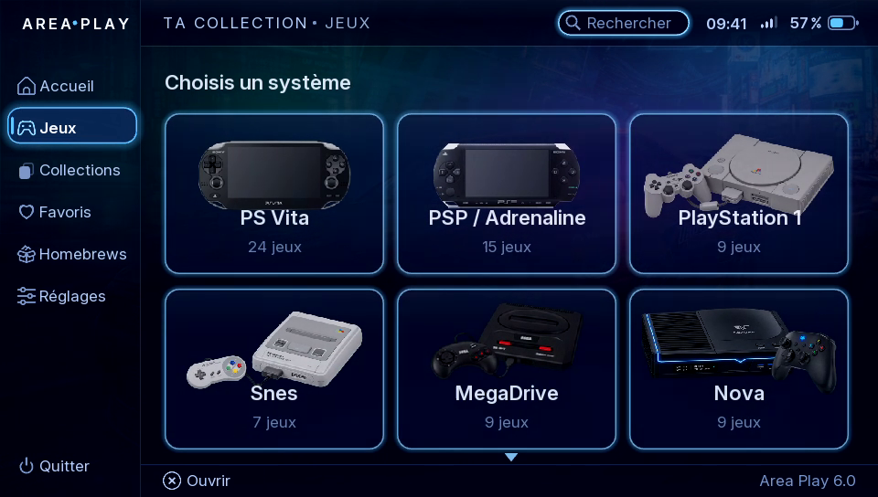</td>
    <td>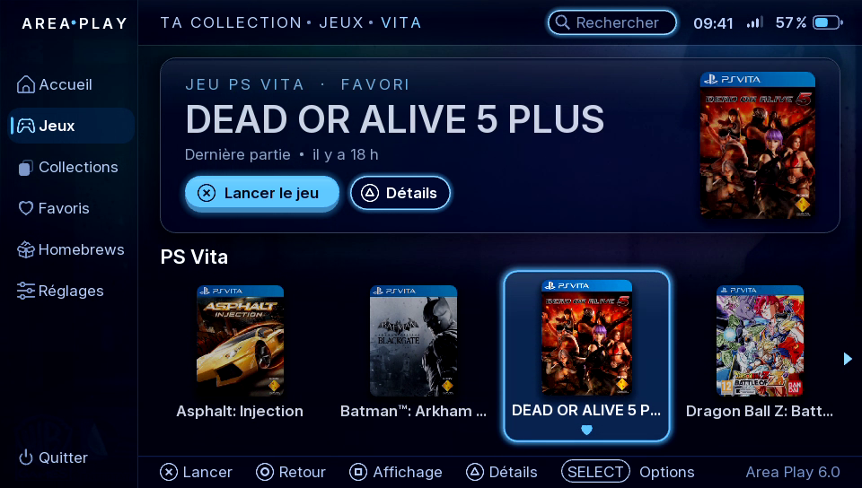</td>
  </tr>
  <tr>
    <td align="center">Accueil : derniers jeux lancés</td>
    <td align="center">Vos systèmes</td>
    <td align="center">Vue carrousel</td>
  </tr>
  <tr>
    <td>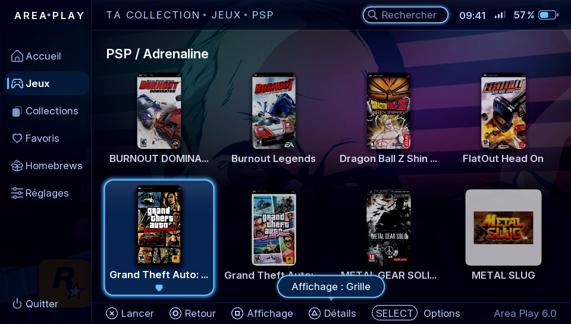</td>
    <td>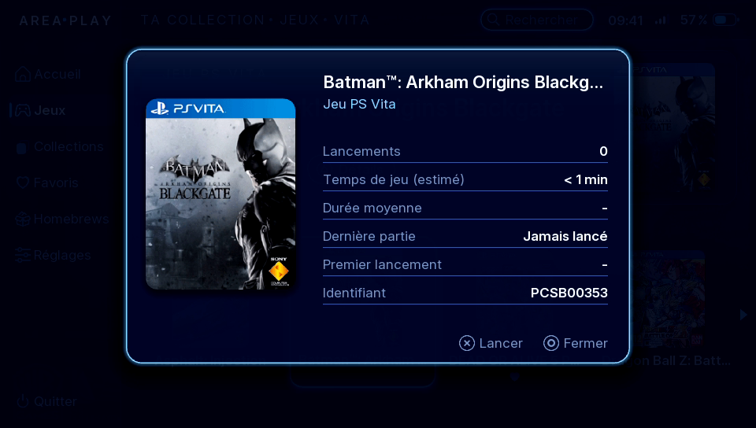</td>
    <td>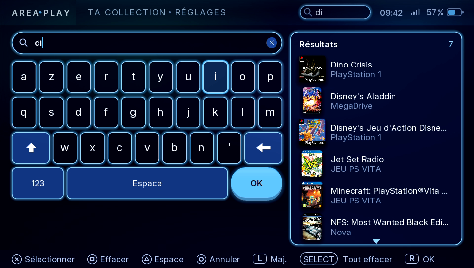</td>
  </tr>
  <tr>
    <td align="center">Vue grille</td>
    <td align="center">Fiche du jeu</td>
    <td align="center">Recherche instantanée</td>
  </tr>
  <tr>
    <td>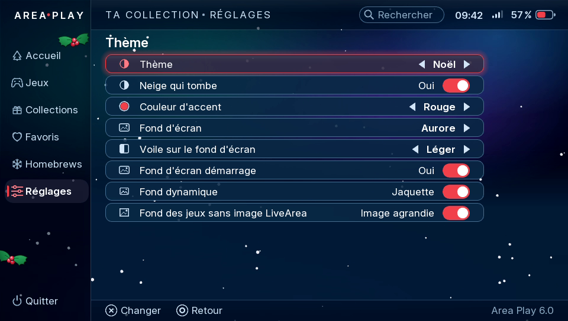</td>
    <td>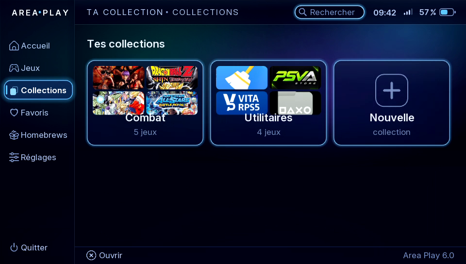</td>
    <td>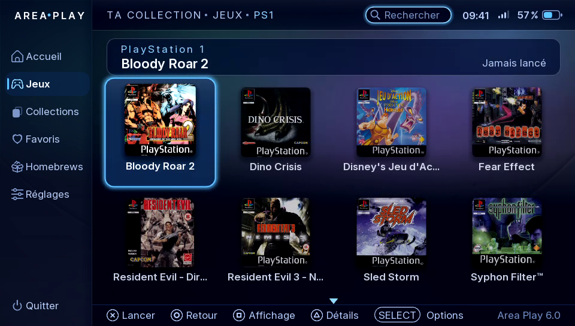</td>
  </tr>
  <tr>
    <td align="center">Thème Noël</td>
    <td align="center">Collections</td>
    <td align="center">Jeux PS1</td>
  </tr>
</table>

<h3 align="center">Nouveautés de la 1.1</h3>
<table>
  <tr>
    <td>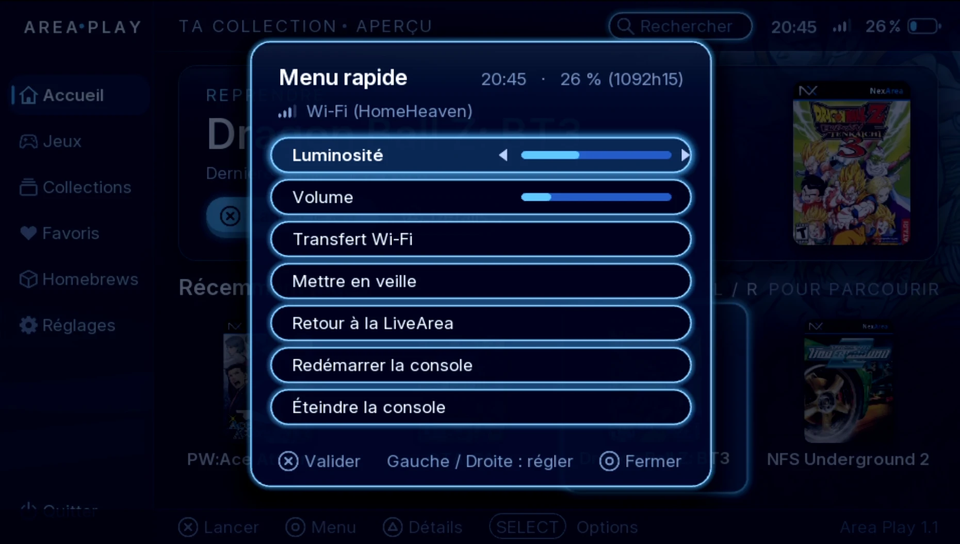</td>
    <td>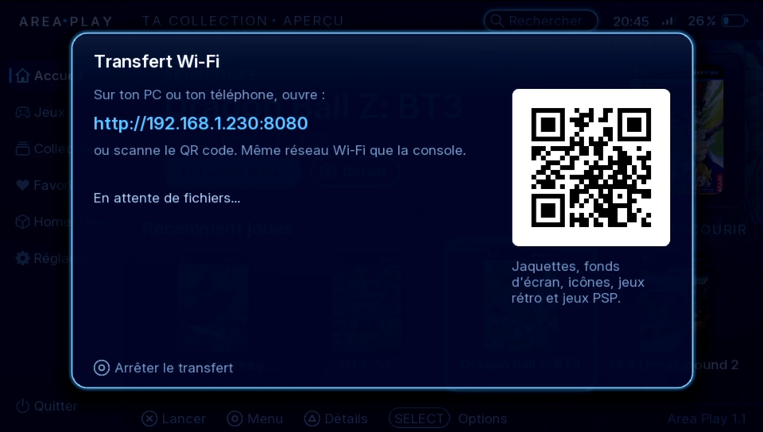</td>
    <td>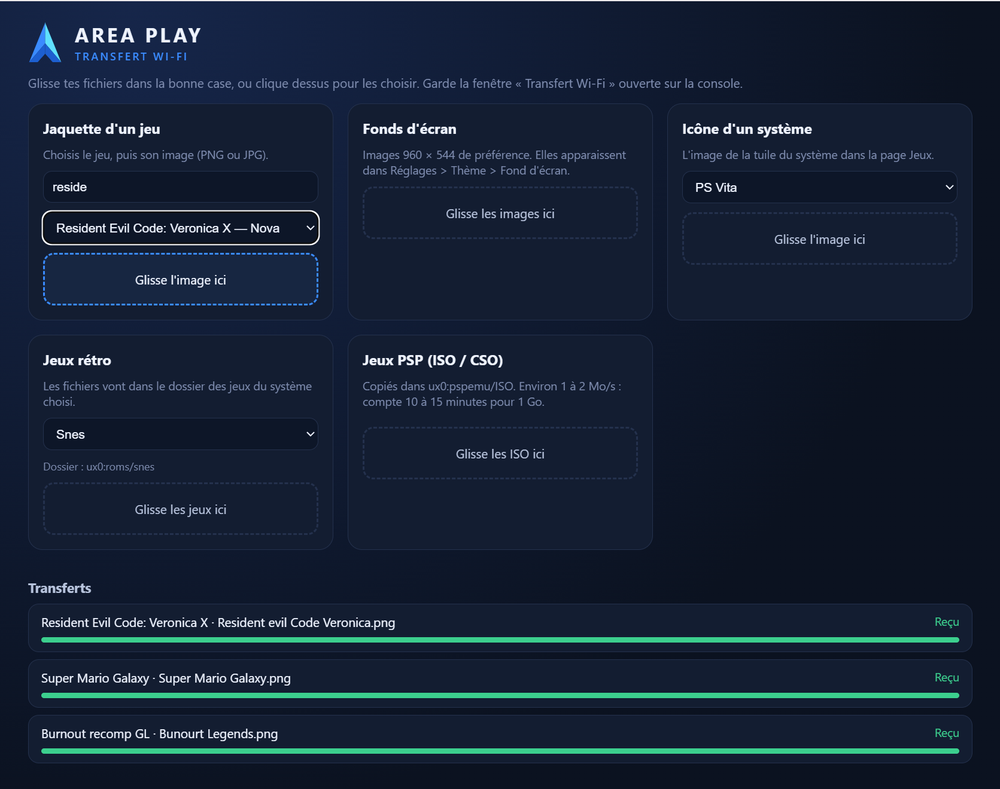</td>
  </tr>
  <tr>
    <td align="center">Menu rapide (START maintenu)</td>
    <td align="center">Transfert Wi-Fi sur la Vita</td>
    <td align="center">Page du transfert Wi-Fi sur PC ou téléphone</td>
  </tr>
  <tr>
    <td>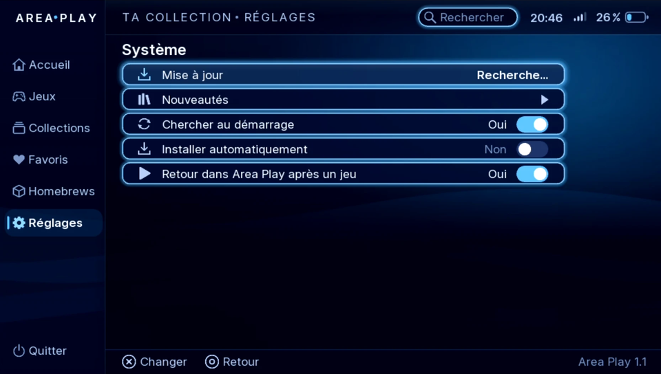</td>
    <td>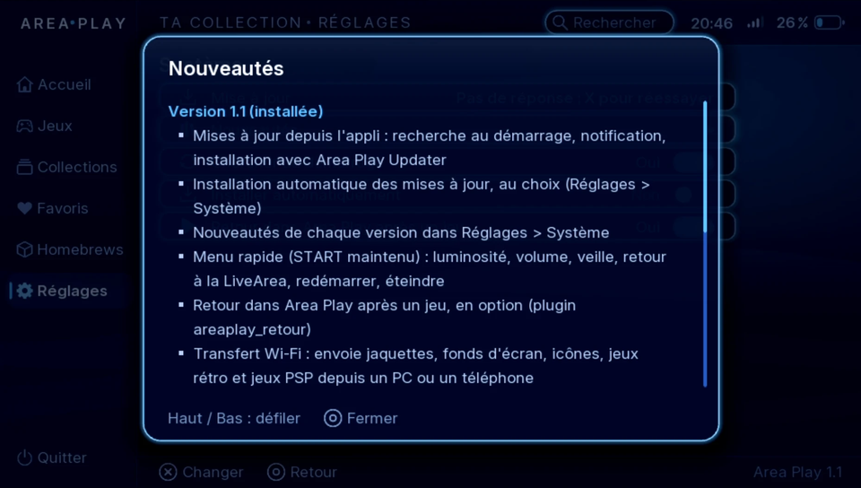</td>
    <td></td>
  </tr>
  <tr>
    <td align="center">Réglages ▸ Système : mises à jour</td>
    <td align="center">Fenêtre Nouveautés</td>
    <td></td>
  </tr>
</table>


## Fonctions

### Toute votre bibliothèque au même endroit
- **Tous vos jeux sur un seul écran :** jeux PS Vita, jeux PSP et PS1 (bulles Adrenaline), homebrews et vos consoles rétro, chacun avec sa tuile de système.
- **Natif et rapide.** Écrit en C avec vita2d. La bibliothèque est lue une fois, puis seulement à la demande : le démarrage reste rapide, même avec des centaines de jeux.
- **Écran d'accueil** avec le dernier jeu lancé en grand, *Récemment joués* en dessous, et un bouton *Lancer le jeu* pour reprendre tout de suite.
- **Jeux rétro lancés directement** avec le bon cœur : RetroArch, Emu4Vita++, ou émulateurs autonomes (DaedalusX64, Flycast, DSVita, Azahar, EasyRPG). L'émulateur se choisit par système dans *Réglages ▸ Bibliothèque ▸ Émulateurs*.
- **EBOOT PS1 sans bulle** par RetroArch, et **ISO / CSO PSP sans bulle** par le lanceur Adrenaline de RetroFlow, si vous l'avez.

### Jaquettes et fonds automatiques
- **Un bouton télécharge tout :** jaquettes et fonds plein écran pour toute la bibliothèque (*Réglages ▸ Bibliothèque ▸ Télécharger jaquettes et fonds*).
- **Recherche par nom intelligente.** Les jeux rétro sont trouvés malgré les fautes, les chiffres romains (II = 2), les sous-titres manquants ou les noms de fichiers avec des tirets.
- **Votre région d'abord** (Europe, France, USA ou Japon), et **une autre version** de la jaquette en deux appuis si vous préférez une autre édition.
- **Vos propres images :** choisissez la jaquette ou le fond de n'importe quel jeu, ou envoyez-les depuis votre téléphone avec le transfert Wi-Fi.

### Naviguez à votre façon
- **Quatre vues par menu :** carrousel, grille, liste et catalogue (un carrousel qui s'ouvre en grille). □ change la vue ; chaque menu garde la sienne.
- **Fiche du jeu** (△) : jaquette, fond, système, dernière partie, lancement.
- **Recherche instantanée** avec un clavier à l'écran, résultats mis à jour à chaque lettre.
- **Favoris, collections, récemment joués**, tri par nom, par dernière partie ou favoris d'abord.
- **Options de chaque jeu** (SELECT) : favori, collections, catégorie, renommer, choisir la jaquette ou le fond, retélécharger, masquer le jeu.
- **Tuiles des systèmes** à 3 ou 4 par ligne ou sur 2 lignes, dans l'ordre que vous voulez.

### À votre goût
- **26 couleurs d'accent**, vos propres **fonds d'écran** avec un voile réglable, un **fond dynamique** tiré de l'image du jeu sélectionné, des cadres glossy.
- **Écran tactile et boutons** partout. **Français et anglais**, d'autres langues arrivent.

### Des outils pratiques
- **Menu rapide** (START maintenu) : luminosité, volume, transfert Wi-Fi, veille, retour au LiveArea, redémarrer, éteindre, avec l'heure et la batterie.
- **Transfert Wi-Fi :** ouvrez l'adresse ou scannez le QR code affichés sur la console, puis déposez jaquettes, fonds d'écran, icônes de systèmes, jeux rétro ou ISO PSP depuis un PC ou un téléphone. Sans câble ni logiciel FTP, et rien n'est jamais supprimé.
- **Retour dans Area Play après un jeu** (option) : quittez un jeu, vous revenez dans Area Play au lieu du LiveArea. Le petit plugin est installé par l'appli elle-même.
- **Mises à jour depuis l'appli :** recherche au démarrage, une petite notification, puis l'installation en un appui par *Area Play Updater*. L'installation automatique est au choix.
- **Connexion sécurisée intégrée** (curl + OpenSSL) : jaquettes et mises à jour quel que soit le firmware, sans iTLS-Enso.
- **Page Réseau :** état du Wi-Fi, adresse IP, et test de connexion des serveurs d'images et de mises à jour.
- **Nouveautés :** les changements de chaque version, dans *Réglages ▸ Système ▸ Nouveautés*.

## Comment ça marche

### Premier démarrage
Area Play lit les bulles installées sur la console et les dossiers de vos jeux rétro, range tout par système et enregistre la liste. Les démarrages suivants relisent cette liste : ils sont immédiats. Après avoir installé ou supprimé des jeux, faites *Réglages ▸ Bibliothèque ▸ Scanner la bibliothèque*.

### Lancer un jeu
Choisissez un système, un jeu, appuyez sur ✕. Les jeux Vita, les homebrews et les bulles Adrenaline démarrent comme depuis le LiveArea. Les jeux rétro démarrent dans l'émulateur choisi pour leur système, sans passer par le menu de RetroArch.

### Jaquettes
Pour les jeux Vita et PSP, les jaquettes sont cherchées par l'identifiant du jeu ; pour les jeux rétro et PS1, par le nom sur le serveur d'images de libretro, dans votre région d'abord. Les images sont rangées dans `ux0:data/AreaPlay/` : elles restent disponibles hors connexion.

## Installation

1. Téléchargez **`AreaPlay.vpk`** dans la [dernière version](../../releases/latest).
2. Installez-le avec VitaShell.
3. Lancez **Area Play** depuis sa bulle. Au premier démarrage, il lit votre bibliothèque, crée `ux0:roms` avec un LISEZMOI pour les systèmes rétro, et installe **Area Play Updater** (une deuxième petite bulle, qui sert seulement à installer les mises à jour).

**Configuration requise**

- PS Vita ou PS TV avec HENkaku / Ensō (testé en 3.65 Ensō).
- Pour les jaquettes et les mises à jour : le Wi-Fi. Pas besoin d'iTLS-Enso : Area Play a sa propre connexion sécurisée (curl + OpenSSL).
- Facultatif : RetroArch, Emu4Vita++ et/ou des émulateurs autonomes pour les systèmes rétro ; Adrenaline pour les jeux PSP et PS1.

### Mises à jour

- Vous n'installez un VPK qu'une fois. Quand une nouvelle version sort, une notification apparaît en haut à droite : **✕ Installer** la télécharge, **○ Plus tard** la replie en une petite icône à côté de « Area Play », en bas à droite.
- *Réglages ▸ Système* : recherche au démarrage, installation automatique, liste des nouveautés.
- Chaque fichier est vérifié (taille et somme de contrôle) avant de remplacer quoi que ce soit. Si un téléchargement échoue, votre version actuelle reste intacte.
- **Vous êtes en 1.0 ?** Installez une fois le VPK 1.1 avec VitaShell ; toutes les versions suivantes arriveront par l'appli.

## Où ranger vos jeux

| Quoi | Où |
|---|---|
| Jeux PS Vita et homebrews | Installés sur la console (bulles du LiveArea) |
| Jeux PSP et PS1 avec bulle | Installés sur la console (bulles Adrenaline) |
| EBOOT PS1 sans bulle | `ux0:pspemu/PSP/GAME/` (lancés par RetroArch) |
| ISO / CSO PSP sans bulle | `ux0:pspemu/ISO/` (avec RetroFlow Adrenaline Launcher, voir plus bas) |
| Jeux rétro | `ux0:roms/<système>/` (un LISEZMOI y est créé au premier démarrage) |
| Jeux 3DS et DS | Dossiers d'Azahar (`ux0:data/azahar/roms`) et de DSVita (`ux0:data/dsvita`) |
| Vos jaquettes et fonds | `ux0:data/AreaPlay/covers/` et `backgrounds/`, ou par le transfert Wi-Fi |

### Transfert Wi-Fi

*Réglages ▸ Réseau ▸ Transfert Wi-Fi*, ou le menu rapide. La console affiche une adresse (par exemple `http://192.168.1.20:8080`) et un QR code. Ouvrez-la sur un PC ou un téléphone connecté au même réseau Wi-Fi :

| Case | Va dans |
|---|---|
| Jaquette d'un jeu | `covers/<identifiant du jeu>`, affichée tout de suite |
| Fonds d'écran | `ux0:data/AreaPlay/wallpapers` (*Réglages ▸ Thème ▸ Fond d'écran*) |
| Icône d'un système | la tuile du système choisi |
| Jeux rétro | le dossier des jeux du système choisi |
| Jeux PSP (ISO / CSO) | `ux0:pspemu/ISO` |

1. Ouvrez la fenêtre de transfert : l'adresse et le QR code s'affichent, avec le nombre de fichiers reçus.
2. Sur le PC ou le téléphone, choisissez une case, le jeu ou le système quand c'est demandé, puis déposez ou sélectionnez vos fichiers. Plusieurs fichiers peuvent être envoyés à la suite, chacun avec sa progression.
3. Fermez la fenêtre avec ○ quand vous avez fini. Si des jeux rétro ou des ISO ont été reçus, la bibliothèque se met à jour toute seule.

**Rien n'est supprimé.** Le transfert ne fait qu'ajouter des fichiers dans ces dossiers : depuis le navigateur, on ne peut ni parcourir, ni renommer, ni supprimer quoi que ce soit sur la console. Seul un fichier du même nom est remplacé, et une nouvelle jaquette ou icône remplace la précédente du même jeu ou système. Les images sont vérifiées (vrai PNG ou JPG), les fichiers sont écrits sous un nom provisoire et gardés seulement une fois complets, et la place libre est vérifiée avant un gros fichier.

Le serveur ne tourne que fenêtre ouverte, et la console reste éveillée pendant ce temps. Le Wi-Fi de la Vita va à 1 à 2 Mo/s environ : comptez 10 à 15 minutes pour un ISO de 1 Go.

### Jeux PSP et PS1

- Les jeux qui ont une bulle LiveArea sont lancés directement.
- Les EBOOT PS1 sans bulle peuvent être lancés par RetroArch (cœur PCSX ReARMed).
- **ISO / CSO PSP sans bulle (facultatif)** : si **RetroFlow** est installé (sa bulle « RetroFlow Adrenaline Launcher » et le module AdrBubbleBooter), Area Play liste les ISO / CSO de `pspemu/ISO` et les lance directement. Faites une fois *Réglages ▸ Bibliothèque ▸ Scanner la bibliothèque* après avoir installé RetroFlow.

Area Play ne fournit jamais d'émulateurs, de BIOS ni de jeux. Utilisez vos propres jeux obtenus légalement.

### Retour dans Area Play après un jeu

Activez *Réglages ▸ Système ▸ Retour dans Area Play après un jeu*. La première fois, Area Play demande confirmation, puis installe lui-même son petit plugin utilisateur `areaplay_return.suprx` (livré dans le VPK) et redémarre la console.

**Ce qui change sur votre console**

- Le fichier `ux0:tai/areaplay_return.suprx` est ajouté.
- Dans le `config.txt` de taiHEN (`ux0:tai/config.txt` s'il existe, sinon `ur0:tai/config.txt`), une ligne est ajoutée sous `*main` :

  ```
  *main
  ux0:tai/areaplay_return.suprx
  ```

  Rien d'autre n'est modifié dans le fichier. L'original est d'abord sauvegardé sous le nom `config.txt.areaplay.bak` ; le nouveau fichier est écrit à côté, relu, et mis en place seulement ensuite. En cas de problème, l'original est remis.
- Quand Area Play est mis à jour, le fichier du plugin est remplacé si besoin ; la ligne de `config.txt` n'est jamais réécrite.

**Comment il fonctionne**

- Area Play écrit votre choix dans `ux0:data/AreaPlay/return.txt` et, juste avant de lancer un jeu, quel jeu il lance.
- Le plugin tourne dans le LiveArea et regarde les applis ouvertes. Quand le jeu indiqué a été ouvert puis fermé, il relance Area Play. Les jeux PSP lancés par Adrenaline sont suivis aussi.
- Il ne détourne rien, ne modifie rien du système et n'a pas de partie noyau. Il attend 20 secondes après le démarrage de la console avant d'agir, et ne fait rien quand l'option est désactivée (pas besoin de redémarrer pour la changer).
- Maintenez **L** au démarrage de la console pour ne pas le charger une fois. Son journal : `ux0:data/AreaPlay/return_log.txt`.

**Pour le retirer :** enlevez la ligne `ux0:tai/areaplay_return.suprx` de `config.txt` (ou remettez `config.txt.areaplay.bak`), redémarrez, puis supprimez le fichier.

## Commandes

| Bouton | Action |
|---|---|
| ✕ | Ouvrir, lancer |
| ○ | Retour |
| △ | Fiche du jeu |
| □ | Changer de vue (carrousel, grille, liste, catalogue) ; sur une tuile de système : la déplacer |
| SELECT | Options du jeu : favori, collections, renommer, jaquette, fond, masquer |
| START (maintenu) | Menu rapide |
| START | Sur un système ajouté : le retirer |

Tout fonctionne aussi à l'écran tactile : un toucher sélectionne, un deuxième ouvre, un glissement fait défiler.

## Dépannage

- **Pas de jaquettes ?** *Réglages ▸ Réseau ▸ Tester la connexion* : il vérifie séparément le serveur des jaquettes et celui des mises à jour.
- **Un jeu manque ?** *Réglages ▸ Bibliothèque ▸ Scanner la bibliothèque*.
- **Autre chose ?** `ux0:data/AreaPlay/log.txt` note ce qu'Area Play a fait (lecture, téléchargements, mises à jour, transferts). Joignez-le à une [issue](../../issues).

## Compiler

Le code de la Vita Edition est dans [`vita/`](vita) : voir [`vita/README.md`](vita/README.md).

## Crédits

- [VitaSDK](https://vitasdk.org) et [vita2d](https://github.com/xerpi/vita2d) (MIT)
- Bibliothèques : libpng, zlib, libjpeg (ce logiciel est basé en partie sur le travail de l'Independent JPEG Group), FreeType (FreeType License), bzip2
- Police : [Inter](https://rsms.me/inter/) de Rasmus Andersson (SIL Open Font License 1.1)
- Jaquettes : [hexflow-covers](https://github.com/jimbob4000/hexflow-covers) de jimbob4000 et [libretro-thumbnails](https://github.com/libretro-thumbnails)
- Installation de l'Updater : modèle d'en-tête de [VitaDeploy](https://github.com/SKGleba/VitaDeploy) de SKGleba (MIT)
- Téléchargements HTTPS : [curl](https://curl.se) (licence curl) et OpenSSL. This product includes software developed by the OpenSSL Project for use in the OpenSSL Toolkit (https://www.openssl.org/). Certificats racines : liste de Mozilla (MPL 2.0)
- Inspiré de RetroFlow et HexFlow (Area Play ne partage aucun code avec eux)

PlayStation, PS Vita et PSP sont des marques de Sony Interactive Entertainment. Area Play est un projet de fan non officiel, sans lien avec Sony.

## Retours

Bugs et idées : ouvrez une [issue](../../issues).

## Licence

Area Play est gratuit, pour un **usage non commercial uniquement** : [PolyForm Noncommercial 1.0.0](LICENSE), © 2026 NexArea. Vous pouvez lire le code, l'étudier et l'adapter pour vous, mais pas le vendre ni l'utiliser dans un produit commercial. La police Inter garde sa licence SIL Open Font License ; le modèle d'en-tête de VitaDeploy garde sa licence MIT.
