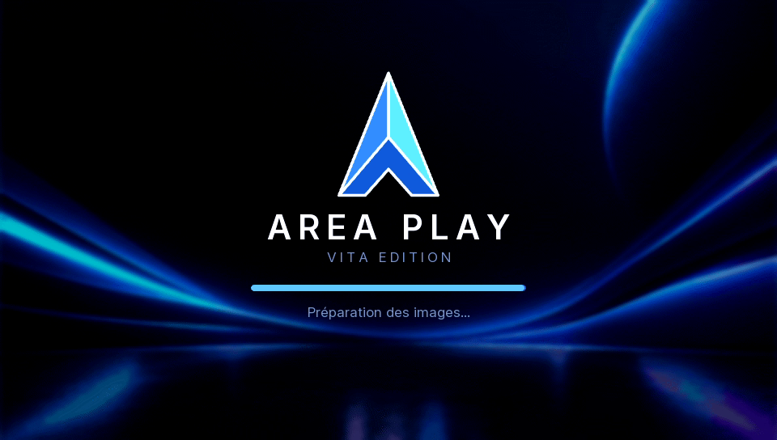
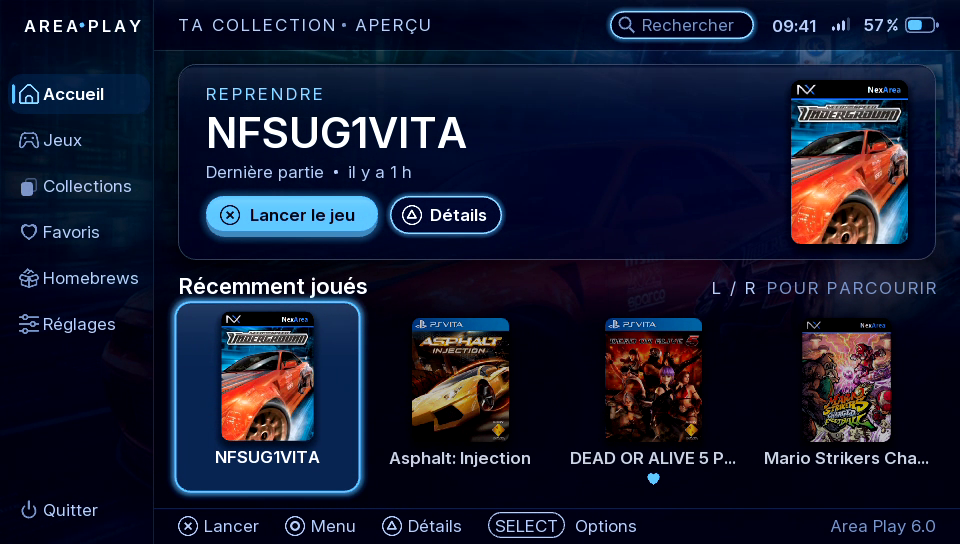
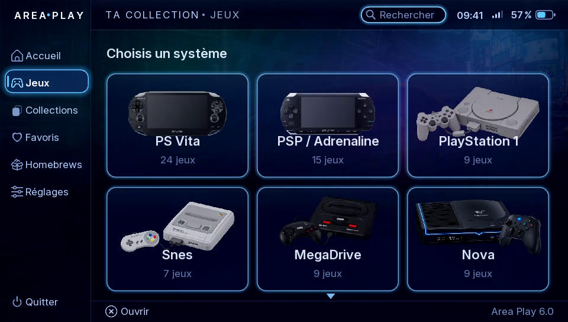
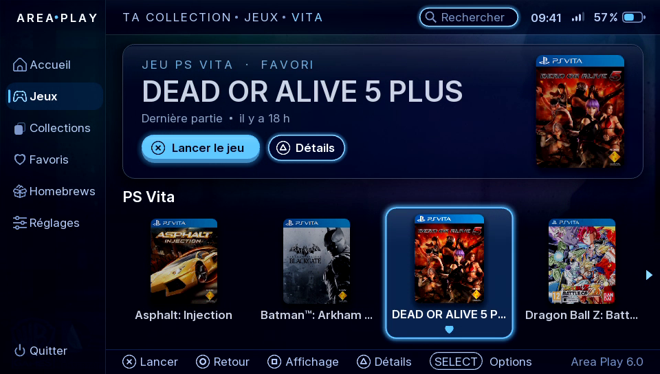
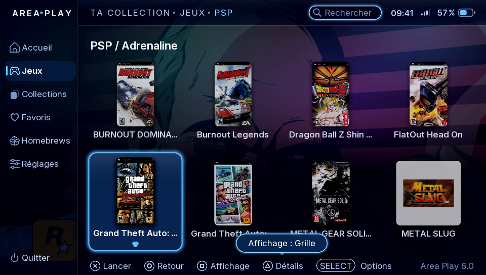
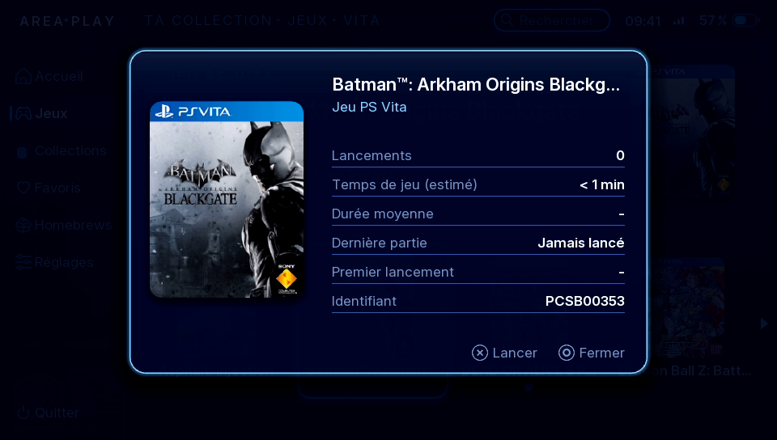
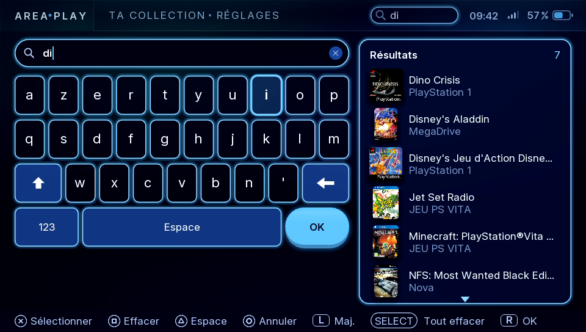
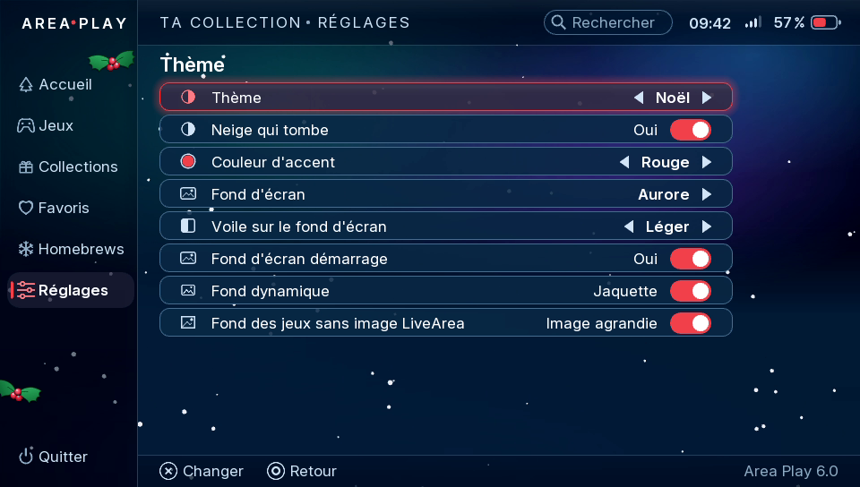
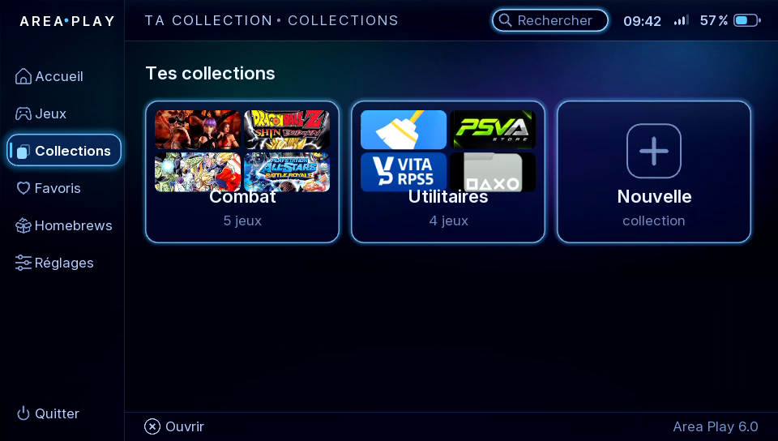

  

<h1 align="center">Area Play</h1>

<b>Un hub de jeux rapide et soigné pour PS Vita</b> 
Vita Edition

<a href="https://youtu.be/WNm3kU46JUY">▶ Voir le trailer</a> · <a href="README.md">English version</a>

---

Area Play rassemble vos **jeux PS Vita, PSP et PS1, consoles rétro et homebrews** au même endroit, avec les jaquettes téléchargées automatiquement. Il fonctionne par-dessus le LiveArea : c'est une appli qu'on lance depuis sa bulle, pas un remplacement du système.

> Conçu, dessiné et testé par moi sur une vraie PS Vita, développé avec l'aide d'une IA.

## Points forts

- **Natif et rapide** : écrit en C avec vita2d. La bibliothèque est lue une fois, puis seulement à la demande : le démarrage reste rapide.
- **Tout au même endroit** : PS Vita, PSP, PS1, homebrews et systèmes rétro.
- **Jeux rétro lancés directement** avec le bon cœur : RetroArch, Emu4Vita++, ou émulateurs autonomes (DaedalusX64, Flycast, DSVita, Azahar, EasyRPG).
- **Jaquettes et fonds automatiques**, région préférée, tolérant aux fautes de frappe, autres versions au choix.
- **À votre goût** : thèmes, 26 couleurs d'accent, fonds d'écran (ou les vôtres), icônes et sons remplaçables, ordre des systèmes, carrousel / grille / liste par menu.
- **Organisez** : favoris, collections, récemment joués, recherche instantanée, renommer un jeu.
- **Écran tactile** et boutons partout. **Français et anglais**, d'autres langues avec un simple fichier texte.

## Captures

| | |
|---|---|
|  |  |
|  |  |
|  |  |
|  |  |

## Configuration requise

- PS Vita ou PS TV avec HENkaku / Ensō (testé en 3.65 Ensō).
- Pour les jaquettes : Wi-Fi et TLS 1.2 (firmware 3.73, ou le plugin iTLS-Enso en 3.60–3.72).
- Facultatif : RetroArch, Emu4Vita++ et/ou des émulateurs autonomes pour les systèmes rétro ; Adrenaline pour les jeux PSP.

## Installation

1. Téléchargez `AreaPlay.vpk` sur la page [Releases](../../releases).
2. Installez-le avec VitaShell.
3. Lancez **Area Play** depuis sa bulle. Au premier démarrage, il lit votre bibliothèque et crée `ux0:roms` avec un LISEZMOI qui explique comment ajouter des systèmes rétro.

| Quoi | Où |
|---|---|
| Jeux PS Vita et homebrews | Installés sur la console (bulles du LiveArea) |
| Jeux PSP et PS1 avec bulle | Installés sur la console (bulles Adrenaline) |
| EBOOT PS1 sans bulle | `ux0:pspemu/PSP/GAME/` (lancés par RetroArch) |
| ISO / CSO PSP sans bulle | `ux0:pspemu/ISO/` (si RetroFlow est installé, voir plus bas) |
| Jeux rétro | `ux0:roms/<système>/` (un LISEZMOI y est créé au premier démarrage) |
| Jeux 3DS et DS | Dossiers d'Azahar (`ux0:data/azahar/roms`) et de DSVita (`ux0:data/dsvita`) |
| Jaquettes et fonds | Téléchargés automatiquement, ou vos images dans `ux0:data/AreaPlay/covers/` et `backgrounds/` |

## Jeux PSP et PS1

- Les jeux qui ont une bulle LiveArea sont lancés directement.
- Les EBOOT PS1 sans bulle peuvent être lancés par RetroArch (cœur PCSX ReARMed).
- **ISO / CSO PSP sans bulle (facultatif)** : si **RetroFlow** est installé (sa bulle « RetroFlow Adrenaline Launcher » et le module AdrBubbleBooter), Area Play liste les ISO / CSO de `pspemu/ISO` et les lance directement. Faites une fois *Réglages > Bibliothèque > Scanner la bibliothèque* après avoir installé RetroFlow. Sans lui, rien ne change : créez des bulles pour vos jeux (par exemple avec Adrenaline Bubbles Manager).

Area Play ne fournit jamais d'émulateurs, de BIOS ni de jeux. Utilisez vos propres jeux obtenus légalement.

## Compiler

Le code de la Vita Edition est dans [`vita/`](vita) (instructions dans [`vita/README.md`](vita/README.md)).

## Crédits

- [VitaSDK](https://vitasdk.org) et [vita2d](https://github.com/xerpi/vita2d) (MIT)
- Bibliothèques : libpng, zlib, libjpeg (ce logiciel est basé en partie sur le travail de l'Independent JPEG Group), FreeType (FreeType License), bzip2
- Police : [Inter](https://rsms.me/inter/) de Rasmus Andersson (SIL Open Font License 1.1)
- Jaquettes : [hexflow-covers](https://github.com/jimbob4000/hexflow-covers) de jimbob4000 et [libretro-thumbnails](https://github.com/libretro-thumbnails)
- Inspiré de RetroFlow et HexFlow (Area Play ne partage aucun code avec eux)

PlayStation, PS Vita et PSP sont des marques de Sony Interactive Entertainment. Area Play est un projet de fan non officiel, sans lien avec Sony.

## Retours

Bugs et idées : ouvrez une [issue](../../issues).

## Licence

Area Play est gratuit, pour un **usage non commercial uniquement** : [PolyForm Noncommercial 1.0.0](LICENSE), © 2026 NexArea. Vous pouvez lire le code, l'étudier et l'adapter pour vous, mais pas le vendre ni l'utiliser dans un produit commercial. La police Inter garde sa licence SIL Open Font License.
