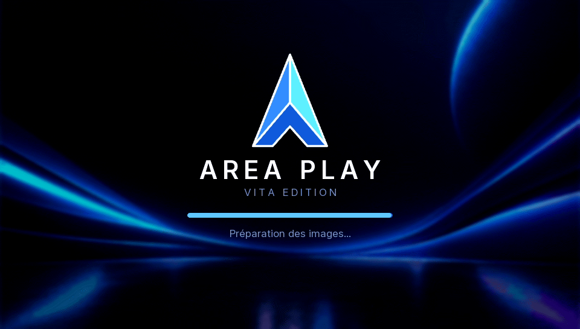
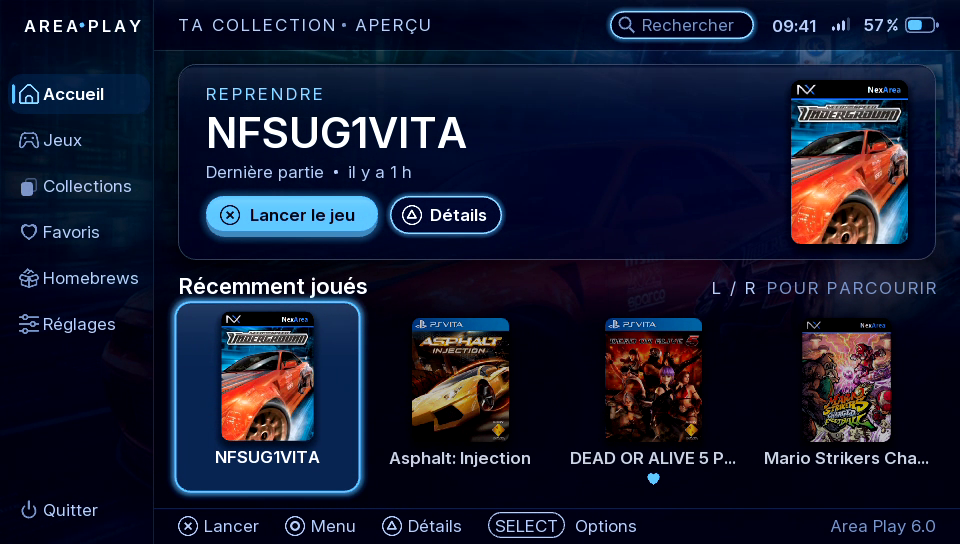
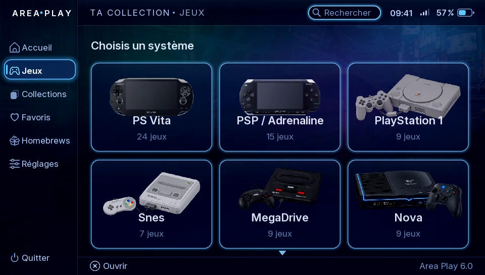
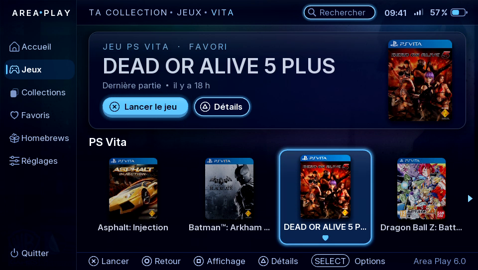
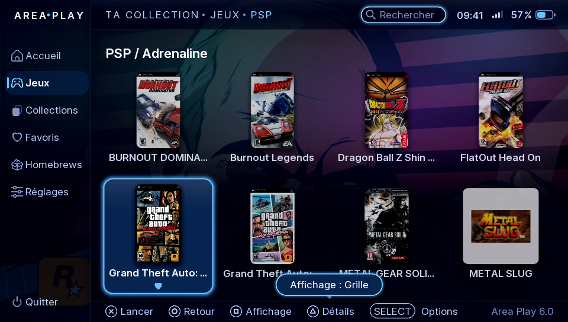
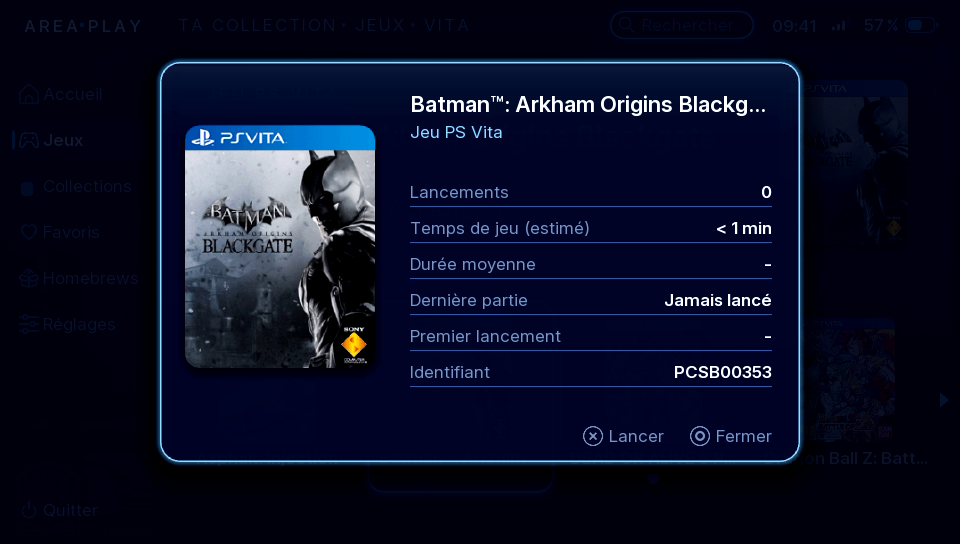
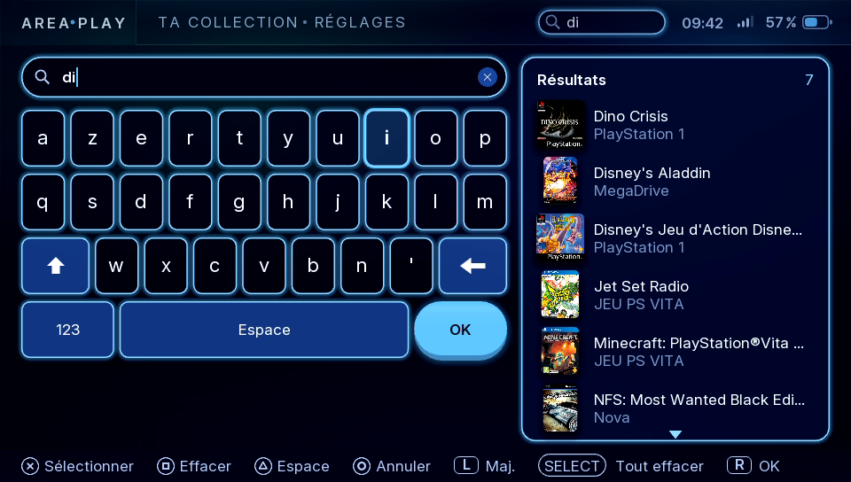
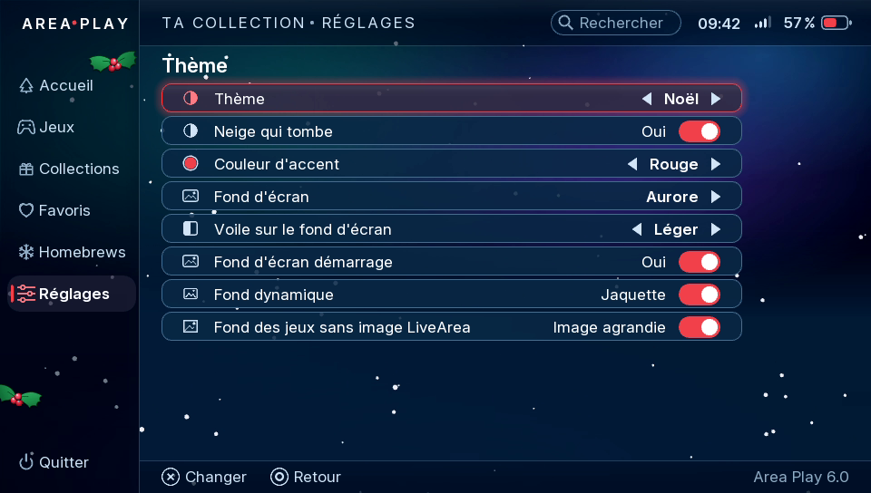
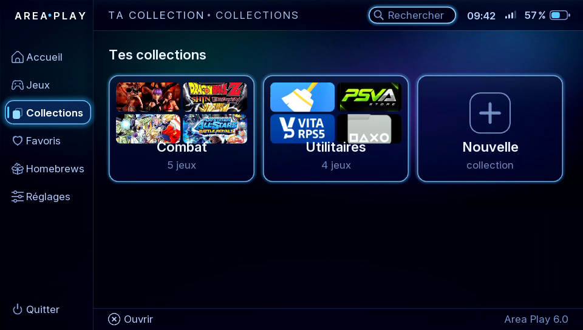

  

<h1 align="center">Area Play</h1>

<b>A fast, good-looking game hub for PS Vita</b> 
Vita Edition

<a href="https://youtu.be/WNm3kU46JUY">▶ Watch the trailer</a> · <a href="README.fr.md">Version française</a>

---

Area Play brings your **PS Vita games, PSP and PS1 games, retro consoles and homebrews** together in one place, with covers downloaded automatically. It runs on top of LiveArea: it is an app you launch from its bubble, not a replacement for the system.

> Designed, drawn and tested by me on a real PS Vita, developed with the help of an AI.

## Highlights

- **Native and fast**: written in C with vita2d. The library is scanned once, then only when you ask, so start-up stays quick.
- **Everything in one place**: PS Vita, PSP, PS1, homebrews and retro systems.
- **Retro games launched directly** with the right core: RetroArch, Emu4Vita++, or standalone emulators (DaedalusX64, Flycast, DSVita, Azahar, EasyRPG).
- **Automatic covers and backgrounds**, preferred region, tolerant to typos, other versions to choose from.
- **Make it yours**: themes, 26 accent colours, wallpapers (or your own), replaceable icons and sounds, system order, carousel / grid / list per menu.
- **Organise**: favourites, collections, recently played, instant search, rename games.
- **Touch screen** and buttons everywhere. **English and French**, more languages through a text file.

## Screenshots

| | |
|---|---|
|  |  |
|  |  |
|  |  |
|  |  |

## Requirements

- PS Vita or PS TV with HENkaku / Ensō (tested on 3.65 Ensō).
- For covers: Wi-Fi and TLS 1.2 (firmware 3.73, or the iTLS-Enso plugin on 3.60–3.72).
- Optional: RetroArch, Emu4Vita++ and/or standalone emulators for retro systems; Adrenaline for PSP games.

## Install

1. Download `AreaPlay.vpk` from the [Releases](../../releases) page.
2. Install it with VitaShell.
3. Launch **Area Play** from its bubble. On first start it scans your library and creates `ux0:roms` with a README explaining how to add retro systems.

| What | Where |
|---|---|
| PS Vita games and homebrews | Installed on the console (LiveArea bubbles) |
| PSP and PS1 games with a bubble | Installed on the console (Adrenaline bubbles) |
| PS1 EBOOTs without a bubble | `ux0:pspemu/PSP/GAME/` (launched through RetroArch) |
| PSP ISO / CSO without a bubble | `ux0:pspemu/ISO/` (if RetroFlow is installed, see below) |
| Retro games | `ux0:roms/<system>/` (a README is created there on first start) |
| 3DS and DS games | Azahar (`ux0:data/azahar/roms`) and DSVita (`ux0:data/dsvita`) folders |
| Covers and backgrounds | Downloaded automatically, or your own images in `ux0:data/AreaPlay/covers/` and `backgrounds/` |

## PSP and PS1 games

- Games with a LiveArea bubble are launched directly.
- PS1 EBOOTs without a bubble can be launched through RetroArch (PCSX ReARMed core).
- **PSP ISO / CSO without a bubble (optional)**: if **RetroFlow** is installed (its "RetroFlow Adrenaline Launcher" bubble and the AdrBubbleBooter module), Area Play lists the ISO / CSO files of `pspemu/ISO` and launches them directly. Run *Settings > Library > Scan the library* once after installing RetroFlow. Without it, nothing changes: create bubbles for your games (for example with Adrenaline Bubbles Manager).

Area Play never ships emulators, BIOS files or games. Use your own legally obtained games.

## Building from source

The Vita Edition source code is in [`vita/`](vita) (instructions in [`vita/README.md`](vita/README.md)).

## Credits

- [VitaSDK](https://vitasdk.org) and [vita2d](https://github.com/xerpi/vita2d) (MIT)
- Libraries: libpng, zlib, libjpeg (this software is based in part on the work of the Independent JPEG Group), FreeType (FreeType License), bzip2
- Font: [Inter](https://rsms.me/inter/) by Rasmus Andersson (SIL Open Font License 1.1)
- Covers: [hexflow-covers](https://github.com/jimbob4000/hexflow-covers) by jimbob4000 and [libretro-thumbnails](https://github.com/libretro-thumbnails)
- Inspired by RetroFlow and HexFlow (Area Play shares no code with them)

PlayStation, PS Vita and PSP are trademarks of Sony Interactive Entertainment. Area Play is an unofficial fan project, not affiliated with Sony.

## Feedback

Bugs and ideas: open an [issue](../../issues).

## Licence

Area Play is free, for **noncommercial use only**: [PolyForm Noncommercial 1.0.0](LICENSE), © 2026 NexArea. You may read, study and adapt the code for yourself, but not sell it or use it in a commercial product. The Inter font keeps its SIL Open Font License.
