<p align="center">
  
</p>

<h1 align="center">Area Play</h1>
<p align="center"><b>A fast, good-looking game launcher for PS Vita</b><br>Vita Edition</p>

<p align="center">
  <a href="../../releases/latest"></a>
  
  
</p>

<p align="center">
  <a href="https://youtu.be/WNm3kU46JUY">▶ Watch the trailer</a> ·
  <a href="../../releases/latest">⬇ Download</a> ·
  <a href="README.fr.md">Version française</a>
</p>

---

**Area Play** puts your whole PS Vita collection on one screen: **PS Vita games, PSP and PS1 games, retro consoles and homebrews**, with covers and backgrounds downloaded automatically. Pick a game, press ✕, play. When you are done, you can come straight back to Area Play.

It is an app launched from its bubble, on top of LiveArea: nothing is replaced on the system, and you can remove it like any other app.

> Designed, drawn and tested by me on a real PS Vita, developed with the help of an AI.

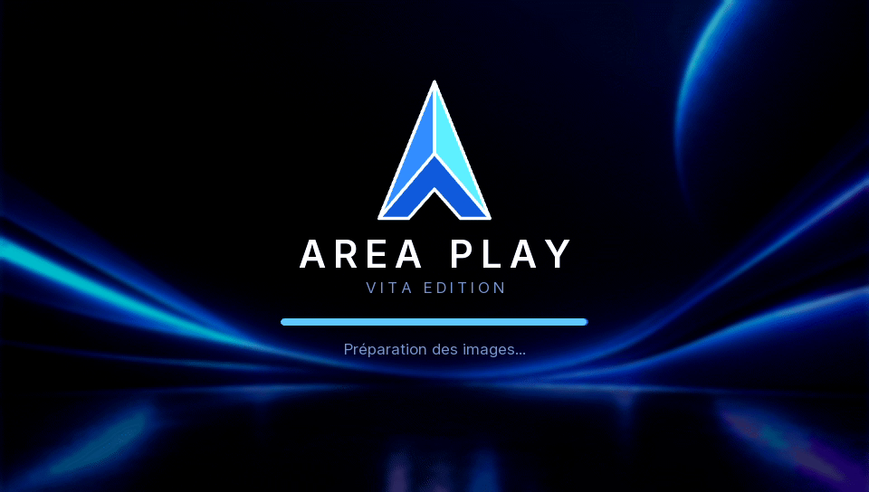

<table>
  <tr>
    <td>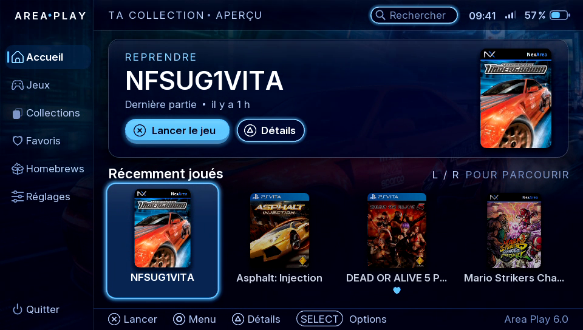</td>
    <td>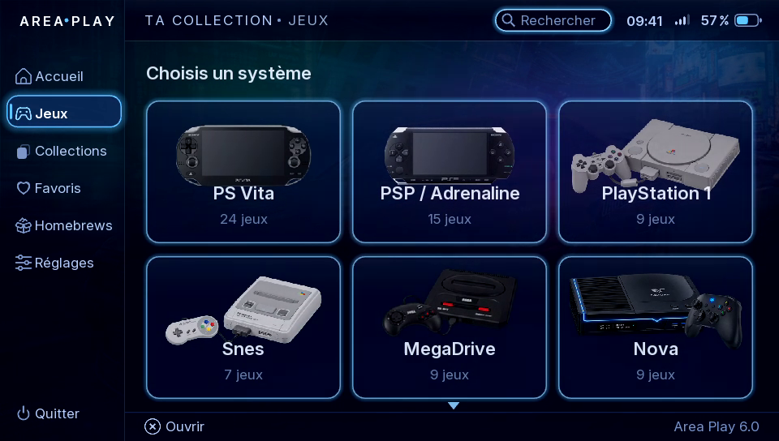</td>
    <td>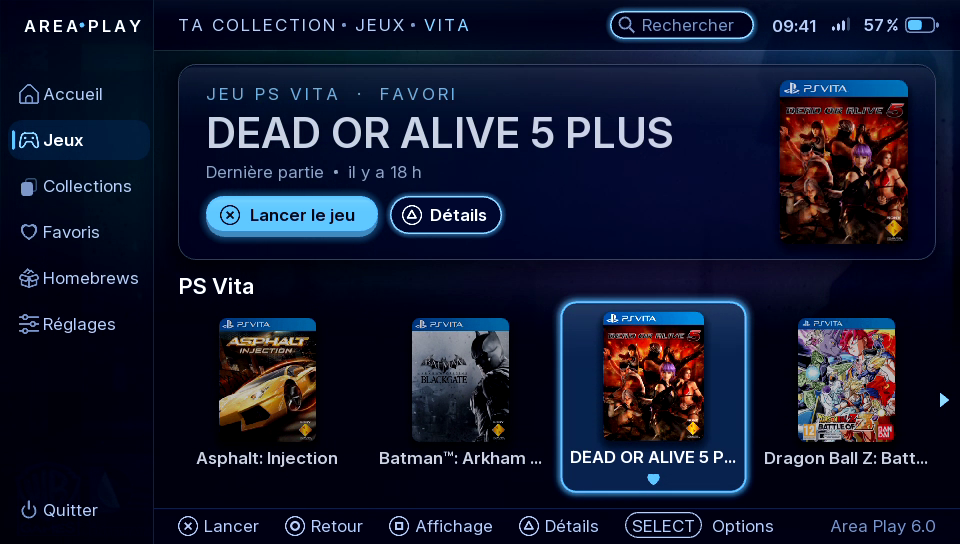</td>
  </tr>
  <tr>
    <td align="center">Home: recently played</td>
    <td align="center">Your systems</td>
    <td align="center">Carousel view</td>
  </tr>
  <tr>
    <td>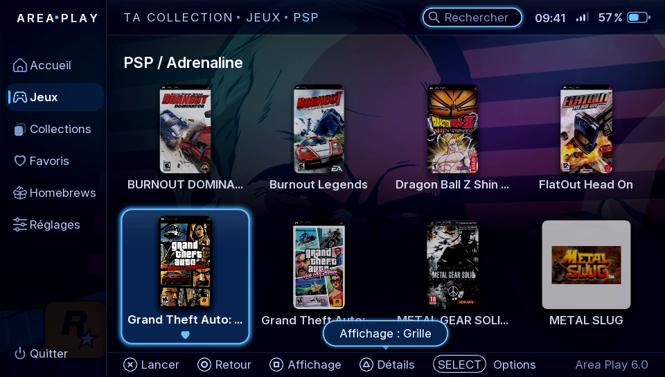</td>
    <td>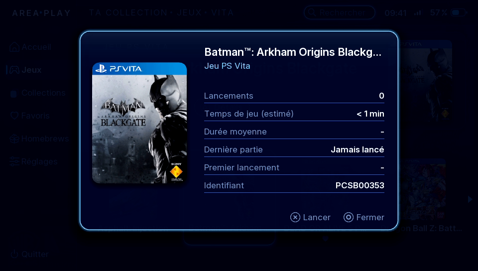</td>
    <td>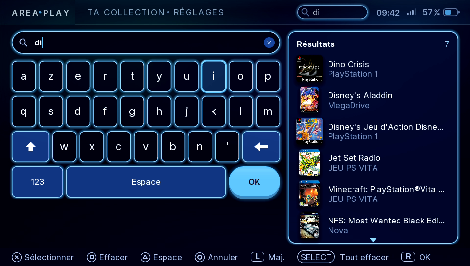</td>
  </tr>
  <tr>
    <td align="center">Grid view</td>
    <td align="center">Game sheet</td>
    <td align="center">Instant search</td>
  </tr>
  <tr>
    <td>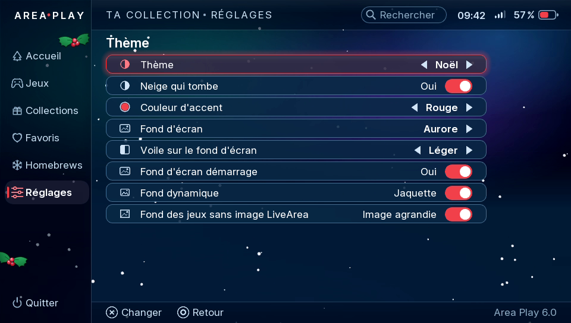</td>
    <td>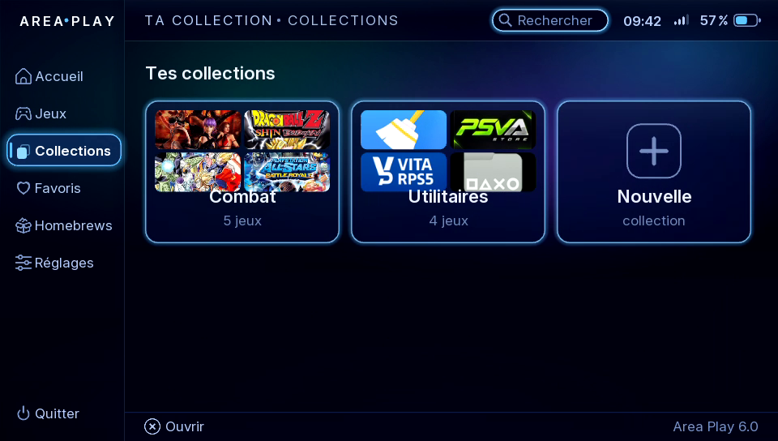</td>
    <td>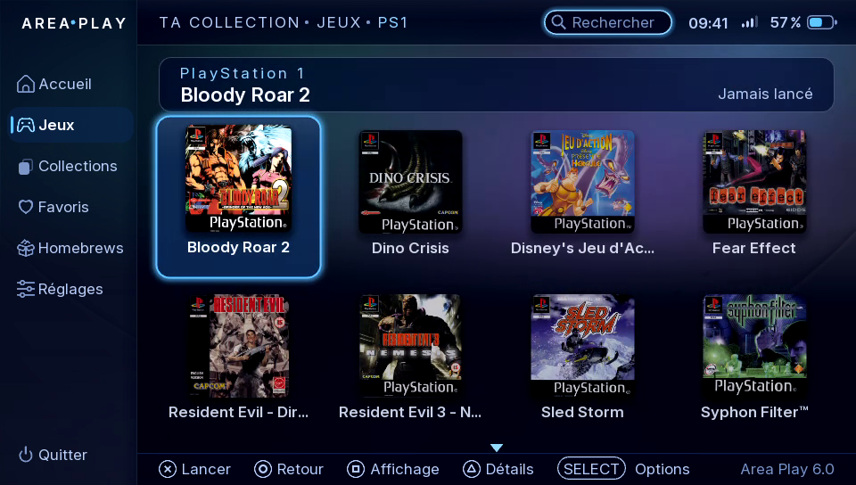</td>
  </tr>
  <tr>
    <td align="center">Christmas theme</td>
    <td align="center">Collections</td>
    <td align="center">PS1 games</td>
  </tr>
</table>

<h3 align="center">New in 1.1</h3>
<table>
  <tr>
    <td>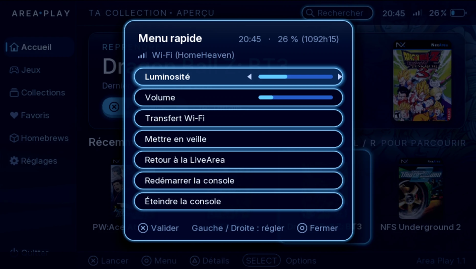</td>
    <td>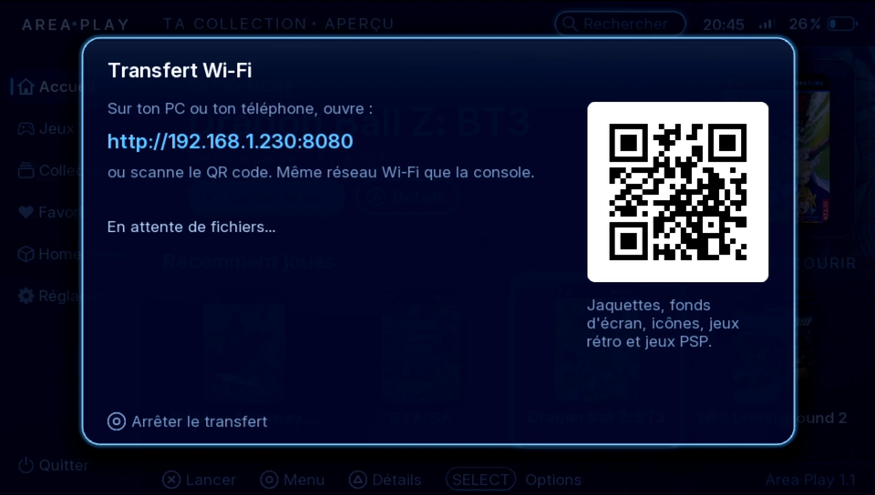</td>
    <td>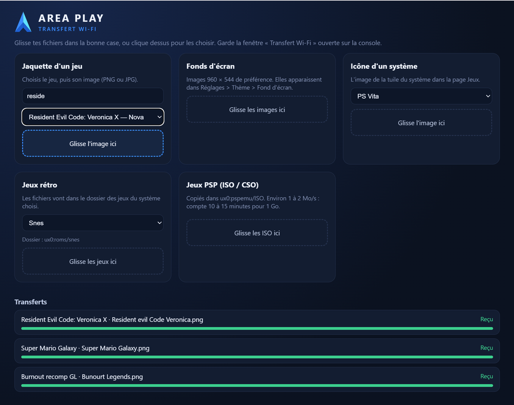</td>
  </tr>
  <tr>
    <td align="center">Quick menu (hold START)</td>
    <td align="center">Wi-Fi transfer on the Vita</td>
    <td align="center">Wi-Fi transfer page on a PC or phone</td>
  </tr>
  <tr>
    <td>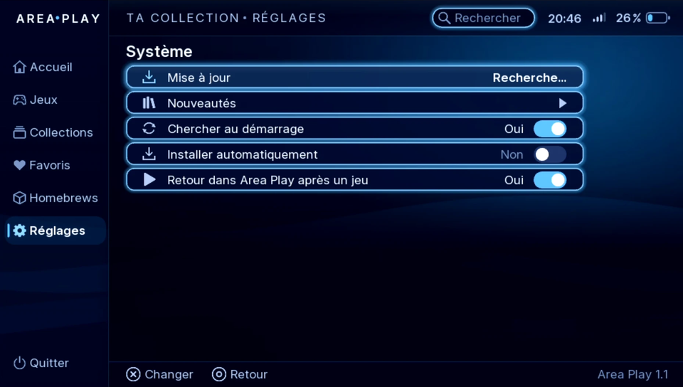</td>
    <td>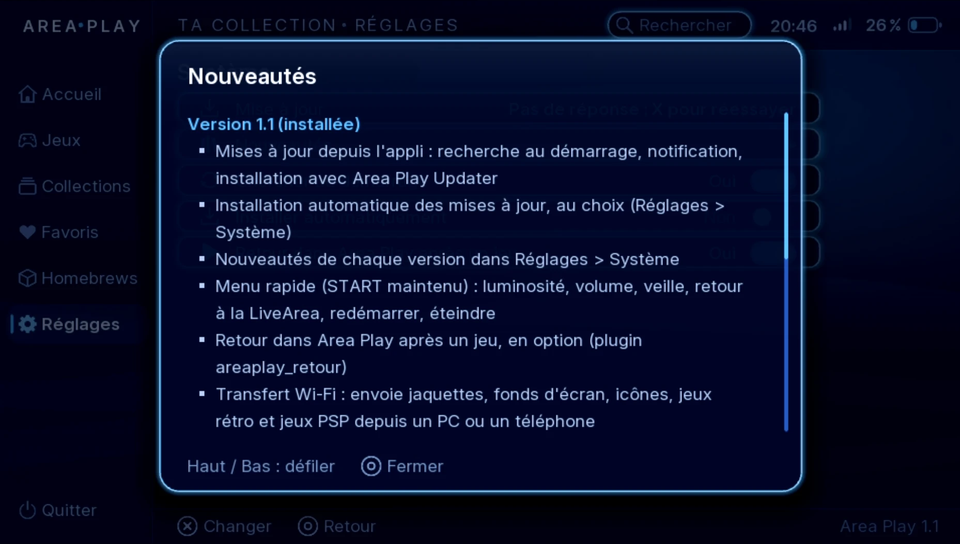</td>
    <td></td>
  </tr>
  <tr>
    <td align="center">Settings ▸ System: updates</td>
    <td align="center">What's new window</td>
    <td></td>
  </tr>
</table>


## Features

### Your whole library, in one place
- **Every kind of game on one screen:** PS Vita games, PSP and PS1 games (Adrenaline bubbles), homebrews, and your retro consoles, each with its own system tile.
- **Native and fast.** Written in C with vita2d. The library is scanned once, then only when you ask: start-up stays quick even with hundreds of games.
- **Home screen** with the last game played in large, *Recently played* below, and a *Launch* button to jump back in.
- **Retro games launched directly** with the right core: RetroArch, Emu4Vita++, or standalone emulators (DaedalusX64, Flycast, DSVita, Azahar, EasyRPG). Choose the emulator per system in *Settings ▸ Library ▸ Emulators*.
- **PS1 EBOOTs without a bubble** through RetroArch, and **PSP ISO / CSO without a bubble** through RetroFlow's Adrenaline launcher, if you have it.

### Covers and backgrounds, automatic
- **One button downloads everything:** box art and full-screen backgrounds for the whole library (*Settings ▸ Library ▸ Download covers and backgrounds*).
- **Smart name matching.** Retro games are found even with typos, roman numerals (II = 2), missing subtitles or dash-separated file names.
- **Your region first** (Europe, France, USA or Japan), and **another version** of a cover in two presses when you prefer a different edition.
- **Your own images:** pick a cover or background for any game, or send them from your phone with the Wi-Fi transfer.

### Browse your way
- **Four views per menu:** carousel, grid, list and catalogue (a carousel that opens into a grid). □ changes the view; every menu remembers its own.
- **Game sheet** (△): cover, background, system, last played, launch.
- **Instant search** with an on-screen keyboard, results updated at every letter.
- **Favourites, collections, recently played**, sort by name, by last played or favourites first.
- **Per-game options** (SELECT): favourite, collections, category, rename, choose the cover or the background, download again, hide the game.
- **System tiles** in 3 or 4 per row or 2 rows, in the order you want.

### Make it yours
- **26 accent colours**, your own **wallpapers** with an adjustable veil, a **dynamic background** from the selected game's art, glossy frames.
- **Touch screen and buttons** everywhere. **English and French**, more languages are coming.

### Handy tools
- **Quick menu** (hold START): brightness, volume, Wi-Fi transfer, sleep, back to LiveArea, restart, power off, with the time and battery.
- **Wi-Fi transfer:** open the address or scan the QR code shown on the console, then drop covers, wallpapers, system icons, retro games or PSP ISOs from a PC or a phone. No cable, no FTP client, and nothing is ever deleted.
- **Back to Area Play after a game** (option): quit a game and you land in Area Play instead of LiveArea. The small plugin is installed by the app itself.
- **Updates from the app:** checked at start-up, a small notification, then a one-press install through *Area Play Updater*. Automatic installation is optional.
- **Built-in secure connection** (curl + OpenSSL): covers and updates work on any firmware, no iTLS-Enso needed.
- **Network page:** Wi-Fi state, IP address, and a connection test for the image and update servers.
- **What's new:** the changes of every version, in *Settings ▸ System ▸ What's new*.

## How it works

### First start
Area Play reads the bubbles installed on the console and the folders of your retro games, sorts everything by system and saves the list. Later starts read the saved list, so they are instant. After installing or removing games, run *Settings ▸ Library ▸ Scan library*.

### Launching a game
Choose a system, choose a game, press ✕. Vita games, homebrews and Adrenaline bubbles start like from LiveArea. Retro games start in the emulator chosen for their system, without going through RetroArch's menu.

### Covers
For Vita and PSP games, covers are looked up by game ID; for retro games and PS1, by name on libretro's thumbnail server, in your region first. Images are stored in `ux0:data/AreaPlay/`, so they stay available offline.

## Install

1. Download **`AreaPlay.vpk`** from the [latest release](../../releases/latest).
2. Install it with VitaShell.
3. Launch **Area Play** from its bubble. On first start it scans your library, creates `ux0:roms` with a README for retro systems, and installs **Area Play Updater** (a second small bubble, used only to install updates).

**Requirements**

- PS Vita or PS TV with HENkaku / Ensō (tested on 3.65 Ensō).
- For covers and updates: Wi-Fi. No iTLS-Enso needed: Area Play brings its own secure connection (curl + OpenSSL).
- Optional: RetroArch, Emu4Vita++ and/or standalone emulators for retro systems; Adrenaline for PSP and PS1 games.

### Updates

- You install a VPK only once. When a new version is out, a notification appears at the top right: **✕ Install** downloads it, **○ Later** folds it into a small icon next to "Area Play" at the bottom right.
- *Settings ▸ System*: check at start-up, install automatically, list of changes.
- Every file is checked (size and checksum) before anything is replaced. If a download fails, your current version stays untouched.
- **Coming from 1.0?** Install the 1.1 VPK once with VitaShell; every following version comes through the app.

## Where your games go

| What | Where |
|---|---|
| PS Vita games and homebrews | Installed on the console (LiveArea bubbles) |
| PSP and PS1 games with a bubble | Installed on the console (Adrenaline bubbles) |
| PS1 EBOOTs without a bubble | `ux0:pspemu/PSP/GAME/` (launched through RetroArch) |
| PSP ISO / CSO without a bubble | `ux0:pspemu/ISO/` (with RetroFlow Adrenaline Launcher, see below) |
| Retro games | `ux0:roms/<system>/` (a README is created there on first start) |
| 3DS and DS games | Azahar (`ux0:data/azahar/roms`) and DSVita (`ux0:data/dsvita`) folders |
| Your own covers and backgrounds | `ux0:data/AreaPlay/covers/` and `backgrounds/`, or through the Wi-Fi transfer |

### Wi-Fi transfer

*Settings ▸ Network ▸ Wi-Fi transfer*, or the quick menu. The console shows an address (for example `http://192.168.1.20:8080`) and a QR code. Open it on a PC or phone connected to the same Wi-Fi network:

| Box | Goes to |
|---|---|
| Game cover | `covers/<game ID>`, shown at once |
| Wallpapers | `ux0:data/AreaPlay/wallpapers` (*Settings ▸ Theme ▸ Wallpaper*) |
| System icon | the tile of the chosen system |
| Retro games | the games folder of the chosen system |
| PSP games (ISO / CSO) | `ux0:pspemu/ISO` |

1. Open the transfer window: the address and QR code appear, with the number of files received.
2. On the PC or phone, pick a box, choose the game or the system when asked, then drop or select your files. Several files can be queued; each one shows its progress.
3. Close the window with ○ when you are done. If retro games or ISOs were received, the library is refreshed by itself.

**Nothing is deleted.** The transfer only adds files to these folders: nothing on the console can be browsed, renamed or deleted from the browser. Only a file with the same name is replaced, and a new cover or icon replaces the previous one of that game or system. Images are checked (real PNG or JPG), files are written under a temporary name and kept only once complete, and the free space is checked before a big file.

The server runs only while the window is open, and the console stays awake meanwhile. The Vita's Wi-Fi does about 1 to 2 MB/s: count 10 to 15 minutes for a 1 GB ISO.

### PSP and PS1 games

- Games with a LiveArea bubble are launched directly.
- PS1 EBOOTs without a bubble can be launched through RetroArch (PCSX ReARMed core).
- **PSP ISO / CSO without a bubble (optional)**: if **RetroFlow** is installed (its "RetroFlow Adrenaline Launcher" bubble and the AdrBubbleBooter module), Area Play lists the ISO / CSO files of `pspemu/ISO` and launches them directly. Run *Settings ▸ Library ▸ Scan library* once after installing RetroFlow.

Area Play never ships emulators, BIOS files or games. Use your own legally obtained games.

### Back to Area Play after a game

Turn on *Settings ▸ System ▸ Return to Area Play after a game*. The first time, Area Play asks for confirmation, then installs its small user plugin `areaplay_return.suprx` (shipped inside the VPK) and restarts the console.

**What changes on your console**

- The file `ux0:tai/areaplay_return.suprx` is added.
- In your taiHEN `config.txt` (`ux0:tai/config.txt` if it exists, otherwise `ur0:tai/config.txt`), one line is added under `*main`:

  ```
  *main
  ux0:tai/areaplay_return.suprx
  ```

  Nothing else in the file is touched. The original is saved first as `config.txt.areaplay.bak`; the new file is written beside it, read back, and only then put in place. If anything goes wrong, the original is restored.
- When Area Play is updated, the plugin file is refreshed if needed; the `config.txt` line is never written again.

**How it works**

- Area Play writes your choice in `ux0:data/AreaPlay/return.txt` and, just before launching a game, which game it launches.
- The plugin runs inside LiveArea and looks at the open apps. When the game it was told about has been opened and then closed, it starts Area Play again. PSP games launched through Adrenaline are followed too.
- It hooks nothing, patches nothing and has no kernel part. It waits 20 seconds after the console starts before doing anything, and does nothing while the option is off (no restart needed to switch it).
- Hold **L** while the console starts to skip it once. Its log is `ux0:data/AreaPlay/return_log.txt`.

**To remove it:** remove the `ux0:tai/areaplay_return.suprx` line from `config.txt` (or put back `config.txt.areaplay.bak`), restart, then delete the file.

## Controls

| Button | Action |
|---|---|
| ✕ | Open, launch |
| ○ | Back |
| △ | Game sheet |
| □ | Change the view (carousel, grid, list, catalogue); on a system tile: move the tile |
| SELECT | Game options: favourite, collections, rename, cover, background, hide |
| START (hold) | Quick menu |
| START | On a system you added: remove it |

Everything also works with the touch screen: tap to select, tap again to open, swipe to scroll.

## Troubleshooting

- **No covers?** *Settings ▸ Network ▸ Test the connection*: it checks the cover server and the update server separately.
- **A game is missing?** *Settings ▸ Library ▸ Scan library*.
- **Something else?** `ux0:data/AreaPlay/log.txt` lists what Area Play did (scan, downloads, updates, transfers). Attach it to an [issue](../../issues).

## Building from source

The Vita Edition source code is in [`vita/`](vita): see [`vita/README.md`](vita/README.md).

## Credits

- [VitaSDK](https://vitasdk.org) and [vita2d](https://github.com/xerpi/vita2d) (MIT)
- Libraries: libpng, zlib, libjpeg (this software is based in part on the work of the Independent JPEG Group), FreeType (FreeType License), bzip2
- Font: [Inter](https://rsms.me/inter/) by Rasmus Andersson (SIL Open Font License 1.1)
- Covers: [hexflow-covers](https://github.com/jimbob4000/hexflow-covers) by jimbob4000 and [libretro-thumbnails](https://github.com/libretro-thumbnails)
- Updater installation: package header template from [VitaDeploy](https://github.com/SKGleba/VitaDeploy) by SKGleba (MIT)
- HTTPS downloads: [curl](https://curl.se) (curl licence) and OpenSSL. This product includes software developed by the OpenSSL Project for use in the OpenSSL Toolkit (https://www.openssl.org/). Root certificates: Mozilla CA list (MPL 2.0)
- Inspired by RetroFlow and HexFlow (Area Play shares no code with them)

PlayStation, PS Vita and PSP are trademarks of Sony Interactive Entertainment. Area Play is an unofficial fan project, not affiliated with Sony.

## Feedback

Bugs and ideas: open an [issue](../../issues).

## Licence

Area Play is free, for **noncommercial use only**: [PolyForm Noncommercial 1.0.0](LICENSE), © 2026 NexArea. You may read, study and adapt the code for yourself, but not sell it or use it in a commercial product. The Inter font keeps its SIL Open Font License; the VitaDeploy header template keeps its MIT licence.
